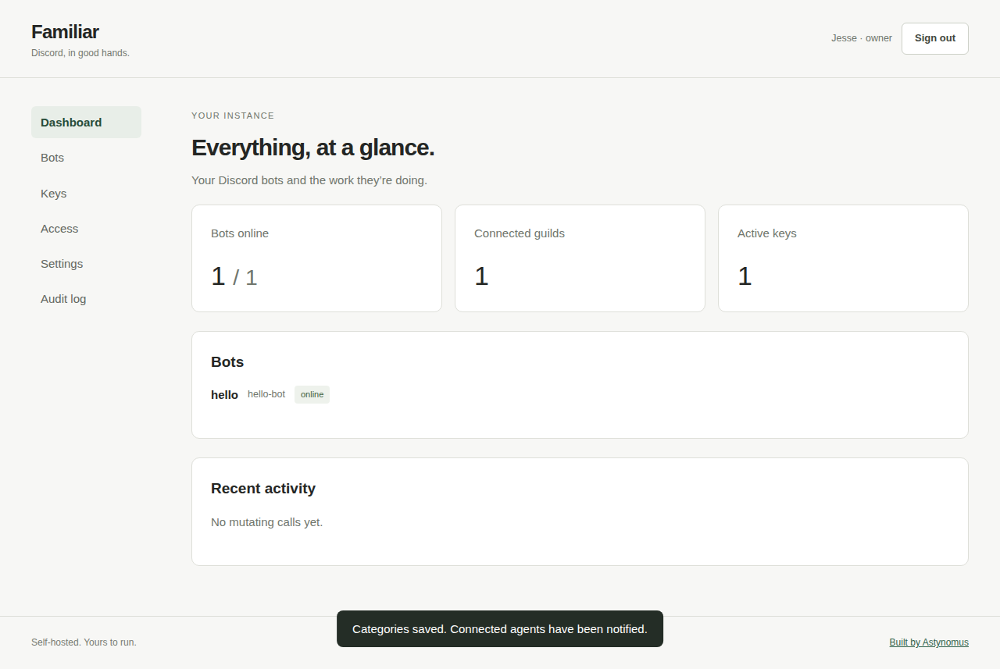

# Familiar

Your Discord bots, available to your agent. Self-hosted, open source, built by
[Astynomus](https://astynomus.com).

Familiar runs an MCP server, a web admin UI, and a SQLite config store in one
process. Bring your own bot tokens. Run a handful of bots with separate identities,
category packs, and scoped keys. Nothing phones home.



## Install

**Back up `MASTER_SECRET` separately from your data volume. Losing it makes stored
bot tokens unrecoverable; you must re-enter them.** Generate it with
`openssl rand -hex 32` and keep it unchanged across restarts.

**Docker Compose (primary):** copy `.env.example` to `.env`, set `DOMAIN`,
`PUBLIC_URL`, and `MASTER_SECRET`, then:

```sh
docker compose up -d
```

Caddy is included and handles automatic HTTPS. Open your domain and enter the
one-time code printed by `docker compose logs app`. The wizard walks through
ownership, adding a bot, choosing categories, and generating a key. Only bootstrap
settings live in the environment; everything else is configured in the UI.

**Laptop / stdio (Node 24+):**

```sh
MASTER_SECRET='<your generated secret>' npx @astynomus/familiar --stdio
```

The UI is at `http://localhost:3000`; the database is in `./data`. Stdio trusts the
local process and needs no API key. HTTP MCP at `/mcp` requires a scoped bearer key.
Use one persistent working directory and one process per instance.

The npm package is `@astynomus/familiar`; the image is
`ghcr.io/astynomus-llc/familiar`. These install commands require the first public
release. Until then, use `npm ci && npm run build && npm start` from this checkout,
or `docker compose up --build -d`.

See [hosting](docs/hosting.md) for setup, proxy configuration, backups, and updates.

## What your agent gets

- Per-session active bot, defaulting to the configured default when in scope.
  Every tool accepts a one-call `bot` override. Every result includes its acting
  bot's slug and name.
- Core orientation tools: `whoami`, `list_bots`, and `set_active_bot`.
- Typed tools for messages, channels, threads, members, roles, moderation,
  webhooks, emojis and stickers, scheduled events, automod, invites, audit log,
  application commands, guilds, users, and voice management.
- `api_request` for Discord REST endpoints without a typed wrapper. It supports
  query strings, JSON bodies, and base64 multipart uploads. Voice audio streaming
  is excluded; joining and managing voice channels is supported.

Category changes and active-bot switches emit MCP `notifications/tools/list_changed`
without reconnecting. Each category is a module with a manifest and tool definitions;
[the registry](src/tools/registry.ts) is the only registration point.

Raw calls use the acting bot's token against Discord API v10. Discord permissions,
privileged-access requirements, and rate limits still apply. Endpoints requiring
user OAuth credentials cannot be made bot-accessible by an MCP server.

## Keys and safety

Keys can cover all bots or a subset, with optional read-only and category ceilings.
Out-of-scope Familiar bots are absent from `list_bots`; switching or overriding to
one returns the same “not found” result as an unknown slug. A single-bot key fixes
identity to that bot. Revocation closes its live sessions immediately.

Core and raw API remain visible. With a category ceiling, typed packs are intersected
with the bot's packs, and raw calls require an explicit `raw_api` grant. Granting raw
API gives full REST reach under the key's bot scope and read-only setting; it is not
limited to the other typed categories. Without that grant, raw calls are rejected.

Destructive typed tools require a confirmation code bound to the exact call, bot,
and session. Codes expire after two minutes and work once. All raw mutations use the
same confirmation flow, because an arbitrary REST route cannot safely be classified
as nondestructive. Server-wide and per-key read-only mode block every mutation.
The local audit log records attempted mutations, confirmation requests, and outcomes
without recording message bodies or tokens.

Bot tokens and the OAuth client secret use AES-256-GCM encryption at rest. API keys
are random verify-only secrets stored as SHA-256 hashes and displayed only once.
Owners control access and ownership; members can manage the other configuration.

## Tool-surface comparison

Based on each project's published README, checked October 22, 2026. “Not documented”
means the README makes no such claim, rather than a claim about all implementation
internals. Sources: [SaseQ/discord-mcp](https://github.com/SaseQ/discord-mcp#readme)
and [v-3/discordmcp](https://github.com/v-3/discordmcp#readme).

| Surface                           | Familiar                                   | SaseQ/discord-mcp                                                                            | v-3/discordmcp           |
| --------------------------------- | ------------------------------------------ | -------------------------------------------------------------------------------------------- | ------------------------ |
| Messages                          | Read, send, edit, delete, bulk delete, pin | Messages, DMs, reactions                                                                     | Send and read            |
| Server management                 | All resource categories listed above       | Channels, members, roles, moderation, webhooks, voice/stage, events, invites, forums, emojis | Server/channel discovery |
| Unwrapped REST endpoints          | Raw API passthrough, including multipart   | Not documented                                                                               | Not documented           |
| Multiple bot identities           | Per-session identity and per-call override | One configured token                                                                         | One configured token     |
| Scoped keys and category controls | Web UI; live tool-list updates             | Not documented                                                                               | Not documented           |

## Development

```sh
npm ci
npm run check
npx playwright install chromium
npm run test:ui
```

Tests mock Discord and OAuth. They cover scope hiding, identity resolution, live HTTP
notifications, encryption, confirmations, read-only enforcement, approval boundaries,
and the browser setup flow. No real Discord token is required. The dashboard image
above uses the same mocked data; a real Discord/Claude demo is a launch task.

The code is plain TypeScript. Storage, bot connections, category definitions, MCP
transports, and web administration have separate modules. No plugin loader, hosted
multi-tenancy, agent-defined event rules, or voice-audio transport is included.

## License and launch

AGPLv3. [LICENSE](LICENSE) is unchanged. Copyright Astynomus LLC.

[Launch checklist](docs/launch.md) tracks publication, the live demo, and directory
submissions. [Built by Astynomus](https://astynomus.com) — see our other products.

## Autonomous server features

Logging, autorole, and welcome run without an agent connection. Open **Bots →
a bot → Servers → a server** to see its module overview. The server stays selected
while you navigate modules. Each module’s master switch suspends its features
without changing their individual switches or settings. Modules default to on;
new servers have no enabled features. The Logging module shares a log channel,
bot filtering, ignored channels, and content settings across seven event features.
Members contains autorole and welcome. Channel and role pickers load from the bot’s
live Discord connection; reconnect an offline bot to refresh choices.

Bot pages keep MCP Tools, Intents, API Keys, Servers, and Audit Log in top tabs.
URLs preserve the selected bot, server, and module. The overview refreshes when
another owner or MCP agent changes configuration.

`list_features` returns modules, shared config, individual feature state, effective
state, and missing intents. `configure_module` patches shared settings and
`set_module_enabled` suspends or restores a module. `configure_feature` patches
individual settings; `set_feature_enabled` changes an individual switch. For
example, configure module `logging` with `channelId`, then enable feature
`logging.messageDeleted`. All feature tools accept a guild ID, an unambiguous name,
or `all` for the current servers. Bulk changes are validated before being saved;
they do not affect servers joined later. The `features` tool category is
independently toggleable, and all its mutations are audited.

On startup, a versioned SQLite transaction migrates v1.1 logging into shared module
config and seven individual features. The old logging enabled state becomes the
master switch; family selections become individual switches. Unknown saved config
is retained. Autorole and welcome retain their settings under Members. Reopening
the database does not repeat the migration.

Bot intent checkboxes control the exact gateway intent set. Saving reconnects the
bot. Enable privileged intents in the Discord developer portal first. Instances
with missing intents remain visible as degraded; events requiring those intents
are skipped while other events continue. Existing bots retain the v1 Guilds and
GuildVoiceStates defaults. Message cache size defaults to 200 messages per channel.
Logging never fetches deleted content: uncached content and unknown actors are
reported as unavailable. Audit correlation is best effort and requires Discord
View Audit Log permission. Autorole also requires Manage Roles and a suitable role
hierarchy; welcome and logging require access to their configured channels.

Feature manifests live in `src/features`, registered only in `registry.ts`, separate
from tool categories. SQLite indexes instances by bot and guild. Command ownership
is persisted per bot and guild; synchronization creates/deletes individual owned
commands, preserving commands managed through application-command tools.
